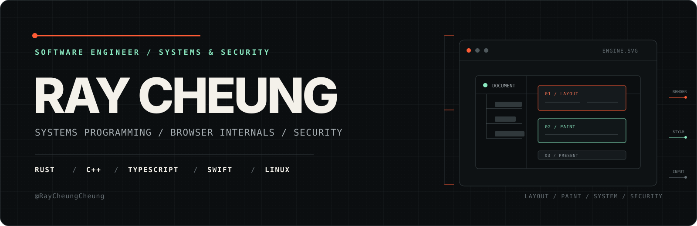
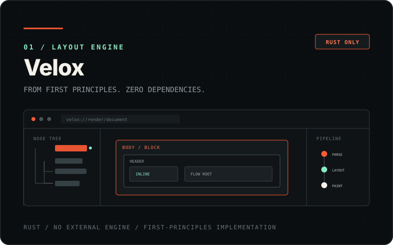
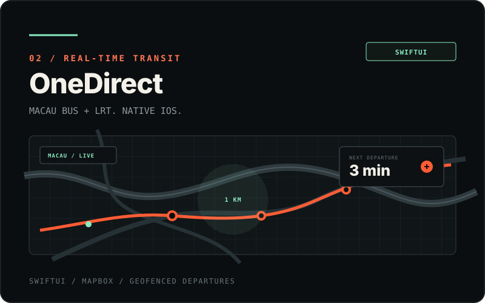
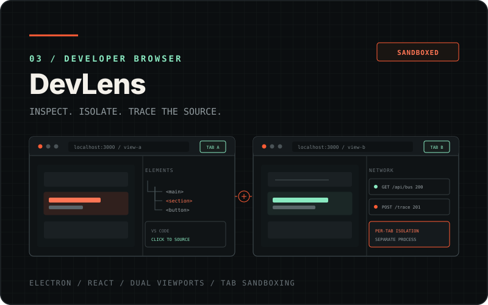
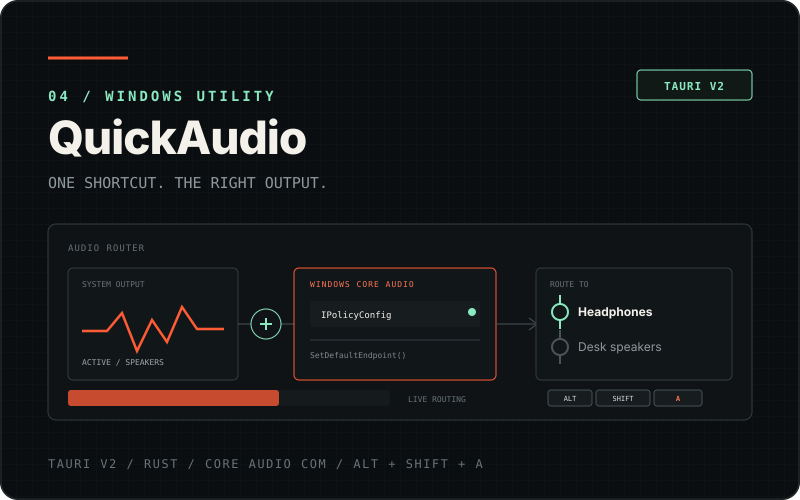

### Systems programming, browser internals, and security.

I build layout engines, desktop utilities, transit software, and CTF tooling.  
Close to the metal. Intentional about every dependency.

## Featured Projects

<table width="100%">
<tr>
<td width="50%" valign="top">

 
<strong>01 / Velox</strong> 
<code>Rust</code> &nbsp; Dependency-free layout and rendering engine built from first principles.
</td>
<td width="50%" valign="top">

 
<strong>02 / OneDirect</strong> 
<code>SwiftUI</code> &nbsp; Real-time Macao bus and LRT app with 1 km geofenced departures.
</td>
</tr>
<tr>
<td width="50%" valign="top">

 
<strong>03 / DevLens Browser</strong> 
<code>Electron</code> &nbsp; Security-focused developer browser with dual viewports and VS Code click-to-source.
</td>
<td width="50%" valign="top">

 
<strong>04 / QuickAudio</strong> 
<code>Tauri v2</code> &nbsp; Windows 11 tray utility controlling Core Audio through <code>IPolicyConfig</code>.
</td>
</tr>
</table>

## Technical Stack

| Domain | Tools |
|:----------------------|:-------------------------------------------------------------------------|
| **Systems** | `Rust` &nbsp;&middot;&nbsp; `C++` &nbsp;&middot;&nbsp; `Python` |
| **Desktop** | `Tauri v2` &nbsp;&middot;&nbsp; `Electron` &nbsp;&middot;&nbsp; Windows Core Audio COM |
| **Web & Mobile** | `TypeScript` &nbsp;&middot;&nbsp; `React` &nbsp;&middot;&nbsp; `Swift` &nbsp;&middot;&nbsp; `SwiftUI` |
| **Platforms & Security** | `Linux (Ubuntu/Kali)` &nbsp;&middot;&nbsp; Web/Pwn CTF |

---

### Links

[**Portfolio**](https://raycheungcheung.github.io/My-Profile) &nbsp;&nbsp;&middot;&nbsp;&nbsp;
[**GitHub**](https://github.com/RayCheungCheung) &nbsp;&nbsp;&middot;&nbsp;&nbsp;
[**Email**](mailto:ms5oi01yy@mozmail.com)

